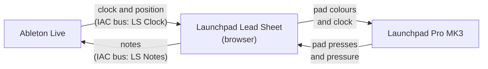
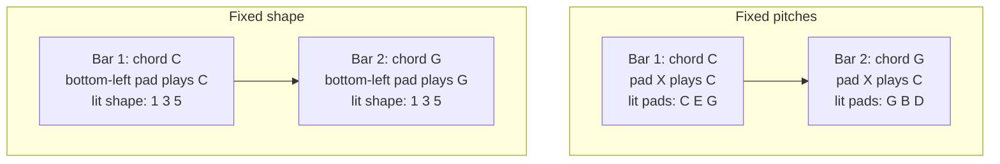
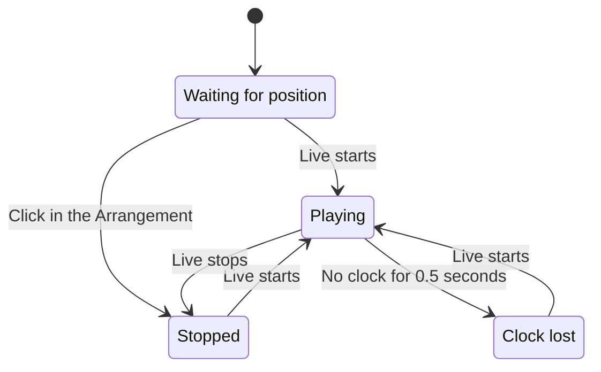
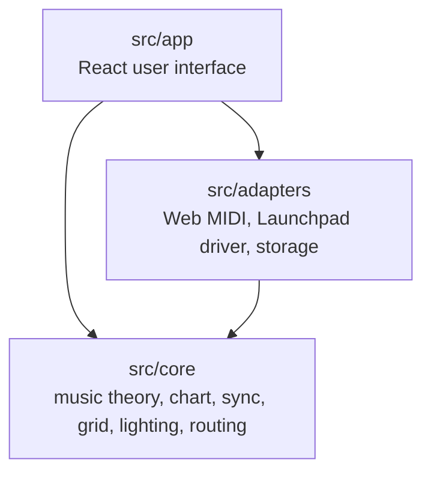

# Launchpad Lead Sheet

Launchpad Lead Sheet is a browser app for Ableton Live and the Novation Launchpad Pro MK3. You write a
chord chart. While Live plays, the app lights the pads that are in the key and in the chord of the
current bar. You play the pads, and the app sends the notes to Live.

The app does not use Max for Live. The app does not install software in Live.

**Open the app:** <https://adam-hanna.github.io/launchpad-lead-sheet/>

## What you need

- A Mac.
- Google Chrome or Microsoft Edge. Safari and Firefox do not have Web MIDI.
- Ableton Live. All editions are applicable, also Live Lite.
- A Novation Launchpad Pro MK3.

## How it works



1. Live sends its clock and its song position to the app.
2. The app finds the current bar in your chart.
3. The app sends the pad colours for that bar to the Launchpad.
4. You press a pad. The app sends the related note to a track in Live.

## Start

Do the full procedure in [docs/live-setup.md](docs/live-setup.md) one time. The procedure takes
approximately ten minutes. This is a summary:

1. In Audio MIDI Setup, make two IAC buses: `LS Clock` and `LS Notes`.
2. In the MIDI settings of Live, set these values:

   | Port                          | Track | Sync |
   | ----------------------------- | ----- | ---- |
   | Output: `IAC Driver LS Clock` | Off   | On   |
   | Input: `IAC Driver LS Notes`  | On    | Off  |
   | Input: `LPProMK3 MIDI`        | Off   | Off  |
   | Output: `LPProMK3 DAW`        | –     | Off  |

3. Set the MIDI Clock Type of the `LS Clock` output to **Song**.
4. Make a MIDI track in Live. Set **MIDI From** to `IAC Driver LS Notes`. Set **Monitor** to **In**.
5. Open the app. Click **Connect MIDI**. Click **Take the Launchpad**.
6. Push Play in Live.

> **Caution:** Open only one page that controls the Launchpad. Two pages change the mode of the
> Launchpad again and again.

> **Note:** Click **Restore Launchpad** before you close the page. If you do not, disconnect the
> Launchpad and connect it again.

## Write a chart

Open the **Sheet** tab and click the text chart button. Each `|` starts a bar. Put the key in braces.

```
title: Example
| {C} Cmaj7 | Am7 | Dm7 G7 | % |
```

| Text     | Meaning                                          |
| -------- | ------------------------------------------------ |
| `{C}`    | The key changes to C major. `{Am}` is A minor.   |
| `Cmaj7`  | One chord for the full bar.                      |
| `Dm7 G7` | Two chords. Each chord gets one half of the bar. |
| `%`      | The bar repeats the chords of the bar before.    |
| `N.C.`   | No chord.                                        |
| (empty)  | The bar continues the key and the last chord.    |

The chord symbols that the app accepts are in [docs/chord-grammar.md](docs/chord-grammar.md).

To repeat the chart, set **Loop bars** in the Sheet tab to the first bar and the last bar.

## Pad colours

The default theme uses these colours:

| Colour                    | Meaning                       |
| ------------------------- | ----------------------------- |
| Pink, flashes on the beat | Root of the chord             |
| Orange                    | Third of the chord            |
| Yellow                    | Fifth of the chord            |
| White (dim)               | Seventh of the chord          |
| Cyan                      | Extension (9, 11, 13)         |
| Blue (dim)                | Other notes of the key        |
| Dark                      | Notes that are not in the key |
| White (bright)            | A pad that you hold           |

You can select a different theme in the **Settings** tab. One theme is safe for colour-blind persons.
You can also make your own theme.

## Grid modes

The **Grid** setting controls what moves when the chord changes.



- **Fixed pitches:** Each pad always plays the same note. The lights move to the notes of the new chord.
- **Fixed shape:** The lights stay in the same position. The notes below the pads move. The same three
  pads play each major chord.

With **Fixed shape**, the setting **Shape anchored on** selects the note of the bottom-left pad:

- **Chord root:** The root of the current chord.
- **Key root:** The root of the current key.

If you hold a pad while the chord changes, the note continues at its initial pitch until you release
the pad.

## Transport states

The header shows the state of the connection to Live.



| State                | What to do                                                   |
| -------------------- | ------------------------------------------------------------ |
| Waiting for position | Push Play in Live, or click in the Arrangement.              |
| Clock lost           | Make sure that Sync is On for `LS Clock` in Live. Push Play. |
| Clock input lost     | Make sure that the IAC bus `LS Clock` is online.             |

The time signature of Live must be the same as the time signature of the chart.

## If there is a problem

- Read the troubleshooting table in [docs/live-setup.md](docs/live-setup.md).
- Add `?debug` to the address of the app. Then open the browser console. The app writes each MIDI event
  to the console.
- If a note does not stop, click **Panic** in the Setup tab.

## Development

You need Node.js 24 and pnpm.

```sh
pnpm install
pnpm dev        # start the app at http://127.0.0.1:5173
pnpm test       # do the unit tests
pnpm e2e        # do the browser test
pnpm spike      # start the hardware test page at http://127.0.0.1:5174
```



`src/core` does not use the browser or React. Thus the tests of `src/core` are fast and complete.

| Document                                                 | Contents                           |
| -------------------------------------------------------- | ---------------------------------- |
| [docs/plan.md](docs/plan.md)                             | The specification of the behaviour |
| [docs/roadmap.md](docs/roadmap.md)                       | The tasks and the milestones       |
| [docs/launchpad-protocol.md](docs/launchpad-protocol.md) | The MIDI messages of the Launchpad |
| [docs/spikes/README.md](docs/spikes/README.md)           | The results of the hardware tests  |
| [docs/hardware-checklist.md](docs/hardware-checklist.md) | The checklist before a release     |
| [docs/performance.md](docs/performance.md)               | The performance data               |
| [CONTRIBUTING.md](CONTRIBUTING.md)                       | The rules for contributions        |

## Limits of version 1.0

- The app operates only on macOS with Chrome or Edge.
- The app operates only with the Launchpad Pro MK3.
- A bar can have a maximum of two chords.
- The chart has one time signature.
- The app does not follow clips in the Session view of Live.
- Three hardware tests are not complete: latency, long operation, and repeated reconnection. Refer to
  [docs/spikes/README.md](docs/spikes/README.md).
